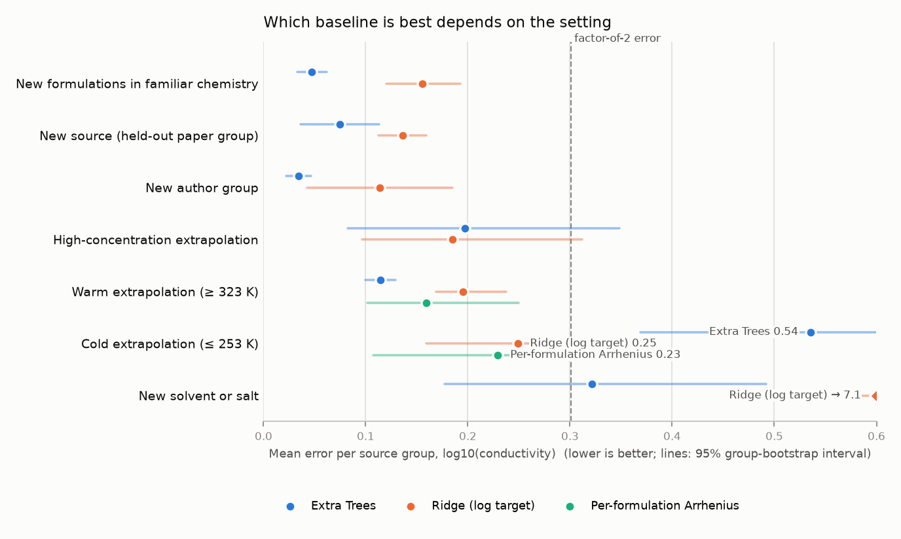

# Electrolyte generalization benchmark

[](https://github.com/anushajain2/electrolyte-benchmark/actions/workflows/tests.yml)

**[Overview page](https://anushajain2.github.io/electrolyte-benchmark/docs/) · [Full report](https://anushajain2.github.io/electrolyte-benchmark/reports/v0.5/report.html) · [Methods](METHODS.md) · [Changelog](CHANGELOG.md)**

This README starts in plain language and gets more technical as it goes. Read as far as you need.

## What this is, in plain terms

Every lithium battery contains a liquid, the **electrolyte**, that carries electric charge between the two ends of the battery. How easily it carries that charge is called its **conductivity**. A battery with a poorly conducting electrolyte charges slowly and loses power, especially in the cold.

Chemists design electrolytes by mixing salts and solvents, and there are far more possible recipes than anyone can measure. So researchers increasingly use computer models trained on past measurements to estimate the conductivity of recipes nobody has tested yet.

The catch is that a model can look very accurate in one kind of test and fail in another. Being good at filling in the gaps between recipes it has seen does not make a model good at predicting what happens at a temperature colder than any in its training data.

This project is a **fair test** (a "benchmark") for such models. It:

1. collects published conductivity measurements of liquid lithium electrolytes (mainly the public CALiSol-23 collection);
2. sets up separate tests that mimic real situations: a new recipe, colder or hotter conditions, a stronger salt concentration, a new ingredient, or data from a lab the model has never seen;
3. checks how well common prediction methods do in each situation;
4. makes sure the tests are honest. Data from the same lab or the same set of experiments is never split between training and test, much as a student should be examined on questions from a different textbook, not the one they studied. Where the public data is too thin for a fair test, the benchmark says so instead of reporting a number.

## What it found, in plain terms

- **There is no single best method.** The method that is best at estimating new recipes made from familiar ingredients is the *worst* at estimating conductivity in the cold: its estimates are about 3.4 times too high. A much simpler approach that follows how conductivity normally falls as a liquid gets colder, fitted to each recipe's own warmer measurements, is off by a factor of about 1.7 instead.
- **There are fewer independent tests than it seems.** The data comes from 27 papers, but many share authors or reuse the same measurements. Once that is accounted for, only 4 groups of papers can serve as a genuinely "new lab" test.
- **Some apparent improvements were an easier test, not better data.** Removing unreliable low readings made errors look smaller, but much of that came from dropping hard test cases.
- **The public dataset contains errors.** Ten measurements were recorded at the wrong temperature. This was confirmed against the original paper, and they are left out here.

The answer to *"which model should I trust?"* therefore depends on what you have already measured and what you want to predict.



*Each row is one kind of test; each dot is a method's typical error (further left is better; the dashed line marks estimates off by a factor of 2). Extra Trees (blue) is best in the first row but worst in the cold-extrapolation row.*

## Who might use this

- **Battery and electrolyte researchers** deciding which prediction method to try first for their situation, and what data that method needs.
- **Machine-learning researchers** who want a conductivity benchmark with realistic, leak-free tests and honest uncertainty, instead of a random split of the data.
- **Maintainers of the dataset**, as a reproducible record of the checks made against original papers.

## Start here

| | |
| --- | --- |
| **[Overview page](https://anushajain2.github.io/electrolyte-benchmark/docs/)** | One page with the three most common situations, three charts and their tables. No raw measurements. |
| **[Full report](https://anushajain2.github.io/electrolyte-benchmark/reports/v0.5/report.html)** | Every test, per-group results, robustness checks, label-quality and selective-prediction investigations, failure cases. |
| **[Evaluate your own model](#evaluate-your-own-model)** | Score your own predictions on the frozen tests from Python ([notebook](notebooks/example_usage.ipynb)) or in the local workbench. |

Written findings: [`reports/findings_v0.5.md`](reports/findings_v0.5.md). How the inputs and baselines work: [`METHODS.md`](METHODS.md). Data card: [`DATA.md`](DATA.md). Open issues: [`ISSUES.md`](ISSUES.md). Version history: [`CHANGELOG.md`](CHANGELOG.md).

## A few terms used below

| Term | Meaning |
| --- | --- |
| Ionic conductivity (mS/cm) | How easily the electrolyte carries charge. Typical room-temperature values are 1–15 mS/cm; in the cold they can fall a hundredfold. |
| Formulation | One specific recipe: which salt and solvents, in which proportions, at which salt concentration. |
| Extrapolation | Predicting outside the range of the training data, for example colder than any measured temperature. |
| Error in log10 | Errors are measured on a logarithmic scale, so being 2× too high and 2× too low count the same. 0.1 log10 is about 26%; 0.3 log10 is a factor of 2. |
| Source group | Papers linked because they share measurements or one experimental campaign. They are always kept on the same side of a train/test split. |
| Arrhenius fit | A straight line through log(conductivity) against 1/temperature for one formulation, the textbook way conductivity changes with temperature over a modest range. |
| Baselines | The reference methods scored here: Extra Trees and gradient boosting (tree ensembles), Ridge (a linear model), k-nearest neighbours, the training median, and the per-formulation Arrhenius fit. |

## Findings in detail

All numbers are from the v0.5 reference, primary track (molality recipes). Error is the mean absolute error of log10(conductivity), averaged per source group so that one large paper cannot dominate.

### 1. For colder temperatures, the ranking flips

| Model | New formulations in familiar chemistry | Cold extrapolation (≤ 253 K) |
| --- | --- | --- |
| Extra Trees | **0.047** | 0.536 |
| Ridge (log target) | 0.155 | 0.249 |
| Per-formulation Arrhenius | not applicable | **0.229** |

Extra Trees is the clear winner for new formulations, with the lowest error in all 7 source groups. Below the coldest training temperature it is the worst: a tree predicts a constant beyond the range it has seen, so its estimates are about 3.4× too high. Both temperature-aware baselines beat it in every one of the 6 cold-extrapolation groups (Arrhenius minus Extra Trees: −0.306, 95% interval −0.399 to −0.226).

A temperature-representation ablation shows this is mainly a model-family effect. Ridge with T alone (0.334) still beats Extra Trees with every feature, and Extra Trees barely changes between T and 1/T ([METHODS.md](METHODS.md)).

*Caveat:* the Arrhenius fit needs at least three warm measurements of the same formulation. Its error grows with distance below the coldest measurement, where electrolytes curve away from a straight Arrhenius line.

### 2. "Cleaner labels" partly meant an easier test

Conductivities below 0.2 mS/cm read from linear-axis plots are unreliable (checked against one original paper). Removing them lowers error, but fold membership has to be held fixed to see why:

- **Source transfer.** About half of the drop comes from cleaner training labels (−0.009 to −0.012 log10 on identical cases). The other half comes from scoring an easier set of cases (−0.016).
- **Cold extrapolation.** The whole improvement comes from the easier test set (−0.024). Cleaning the training labels changes nothing (+0.001).

### 3. 27 papers give only 4 testable source groups

Papers that reuse each other's measurements or report one campaign are grouped before any split, so a held-out source is not secretly in training:

- 27 papers, of which 26 have usable rows;
- 12 papers in the primary track;
- **7 source groups** after provenance linking, from **3 author groups**;
- **4 source groups** (and 2 author groups) testable when held out.

Claims about "transfer to new labs" rest on that many units, and the results are reported per group.

### 4. Ten CALiSol rows carry wrong temperatures

Rows 10075–10078 and 10107–10112 of CALiSol-23 (Ding, Xu & Jow 2005, LiBOB in EC/PC) hold values that belong to temperatures 30–70 K colder than stated. Two independent checks find exactly these ten rows: the paper's own fitted functions, and internal consistency. They are **excluded from the v0.5 reference** (rule R13), each with a review record (`data/evidence/corrections_review_record.csv`). A report for the dataset maintainers is drafted but not yet submitted.

## Run it yourself

```bash
uv sync --extra dev          # Python 3.12, versions pinned in uv.lock
uv run elbench all           # ingest -> curate -> audit -> make-splits -> train -> evaluate -> investigate -> report -> overview
uv run elbench verify        # compare the report tables on disk with the published reference tables (no rerun)
uv run elbench reproduce     # rebuild everything from the raw files in a clean copy, then verify there
uv sync --extra workbench && uv run elbench workbench   # local evaluation workbench (after `elbench all`)
uv run pytest                # scientific-invariant tests and a small end-to-end fixture run
```

A full run takes about 20–30 minutes on a 12-core laptop CPU (no GPU). Every command accepts `--config` (default `configs/benchmark_v0.5.yaml`) and writes a run manifest (config hash, input and output checksums, package versions, wall/CPU time, peak memory).

| Command | Writes |
| --- | --- |
| `elbench ingest` | `data/raw/<dataset>/<release>/…` (read-only), `data/raw/sources.csv` |
| `elbench curate` | `data/processed/v0.5/{measurements,components}.parquet`, `exclusions.csv`, `copy_links.csv`, `curation_rules.csv` |
| `elbench audit` | `reports/v0.5/coverage.html`, `eligibility.csv`, `audit/*.csv` (built before any model is fitted) |
| `elbench make-splits` | `splits/v0.5/manifest__<task>__<track>.csv.gz`, `folds.csv`, `leakage_checks.json` |
| `elbench train`, `elbench evaluate` | `results/v0.5/predictions/…`, `tables/{summary,group_metrics,bootstrap,group_rankings}.csv` |
| `elbench investigate` | `results/v0.5/investigation/*.csv` |
| `elbench report`, `elbench overview` | `reports/v0.5/report.html`; `docs/index.html` and `docs/settings_overview.png` |
| `elbench verify` | `reports/v0.5/verify.json` |

`--confirm` on `train`, `evaluate` and `investigate` runs the **reserved** external evaluation (Rahmanian et al.). Each use is appended to `results/<version>/reserved_exposure_log.csv`. Its labels were scored once each in v0.1, v0.2 and v0.3 (not rescored since), so it is no longer a blind test.

## Evaluate your own model

```python
import pandas as pd
from elbench.config import load_config
from elbench.submission import iter_folds, score_predictions

cfg = load_config("configs/benchmark_v0.5.yaml")
preds = []
for fold in iter_folds(cfg, "source_transfer", "molal_w"):
    model = my_fit(fold.X_train, fold.y_train, dev_folds=fold.dev_folds)   # tune on dev folds only
    preds.append(fold.prediction_frame(my_predict(model, fold.X_test)))     # mS/cm
result = score_predictions(cfg, "source_transfer", "molal_w", pd.concat(preds))
```

- `fold.rows_train` / `fold.rows_test` give the canonical inputs (components, temperature, concentration basis, provenance) if you want your own representation.
- Predictions are joined by ID; duplicate, missing or unexpected IDs are rejected.
- `mode="full_coverage"` (default) needs a valid prediction for every case. Any abstention or failure leaves the submission with diagnostics only, the same rule applied to baselines.
- `mode="selective"` accepts intentional abstentions with a `confidence` column and returns error versus coverage.
- Declare your training data: anything pretrained on conductivity data may have seen these labels.

The workbench (`elbench workbench`) wraps the same API around one question: *given the measurements I already have, which approach deserves further validation?* It runs locally because scoring needs CALiSol labels, which are not redistributed. It has not yet been tested with researchers.

## Methodology and limitations (technical)

**Data.** CALiSol-23 (27 papers, 13,825 rows) is the backbone. The Rahmanian et al. automated-lab dataset (5,035 measurements) is reserved for external confirmation. Raw files are pinned and checksummed. Original values and units are kept next to canonical ones, every transformation cites a rule id, and excluded rows stay visible with a reason.

**Tracks.** Molality and molarity are never converted into each other without densities: `molal_w` (primary; mol/kg with mass fractions), `molar_x` (mol/L with mole fractions), `molar_v` (mol/L with volume fractions).

**Source groups.** Papers are linked when comparable points agree within 5% for at least half of ≥20 pairs (rule R12). A source group is the connected component: a conservative provenance-based grouping, not a demonstrated single campaign. Evidence tiers per pair are in `reports/v0.5/provenance_pairs.csv`.

**Tasks** (split membership frozen in manifests):

| Task | Construction | Permitted conclusion |
| --- | --- | --- |
| `interp_formulation` | whole formulations held out; every test chemistry system stays in training | new formulations in familiar chemistry |
| `source_transfer` | one source group held out; scored only on its local (T, c) support with training | transfer across sources within observed support |
| `author_transfer` | one author group held out | transfer across research groups (2 testable units) |
| `component_transfer` | every record containing a solvent or salt held out | transfer to that component, with concurrent source and condition shifts reported |
| `temp_high`, `temp_low` | same formulations on both sides of a declared boundary (train ≤ 313.15 K / test ≥ 323.15 K; train ≥ 263.15 K / test ≤ 253.15 K) | condition extrapolation in familiar chemistry |
| `conc_high` | fixed solvent recipe; train c ≤ 1.2, test c ≥ 1.5 mol/kg | concentration extrapolation |
| `external_rahmanian` | reserved; train on CALiSol, test on a new automated lab | narrow source transfer |

**Baselines.** Training median, k-nearest neighbours, Ridge (log target, plus a raw-target diagnostic), Extra Trees, histogram gradient boosting, and a per-formulation Arrhenius fit for temperature tasks. They share one fixed 32-column feature set with no source identifiers ([METHODS.md](METHODS.md)). Up to 12 configurations per family are chosen on nested development folds that mimic each task, with 3 seeds for stochastic models.

**Metrics.** MAE of log10(conductivity / mS cm⁻¹), averaged within source groups and then equally across groups. Intervals come from a paired bootstrap that resamples groups, never rows. Comparisons use one common set of (fold, measurement) cases, and a model with any invalid prediction is excluded from rankings.

**Limitations.**
- Seven source groups from three author groups are not independent laboratories. Intervals are conditional on the grouping.
- Every version after v0.1 was made after earlier test results had been seen, so the results are evidence for further validation, not a blind leaderboard.
- The feature set cannot represent ion pairing, mixture-specific solvation, viscosity or phase changes.
- Component transfer is confounded with source and condition shift in every fold, so it is reported as case studies.
- Selective-prediction results are exploratory.
- The workbench has not been tested with users.

Scope: research screening support. This release does not predict SEI chemistry, cycle life, safety or overall battery suitability. It includes exploratory selective prediction for cold extrapolation; it does not include a molecular representation model.

## Repository layout

```
configs/benchmark_v0.*.yaml   every threshold, tolerance, grid and seed for each version
data/mappings/                reviewed name -> structure mapping, source metadata, author groups
data/evidence/                checks against original papers (fitted functions, review records)
data/raw/sources.csv          release ids, URLs, retrieval dates, checksums, licences
src/elbench/                  pipeline, models, evaluation, investigation, report, overview, workbench, cli
splits/v0.*/                  frozen manifests + leakage check record, per version
results/v0.*/                 run records, tables, investigation (predictions and models are rebuilt, not committed)
reports/                      findings, reports, coverage audit, evidence, reference tables for `verify`
docs/                         aggregate-only overview page and README figure (served by GitHub Pages)
tests/                        unit, invariant and end-to-end tests
```

Extra Trees and k-NN fitted objects are not stored (hundreds of MB per fold); they refit exactly from the recorded configuration, seed and manifest.

## Data licences

CALiSol-23's author repository has no licence file, so raw CALiSol rows are **not redistributed**: `elbench ingest` downloads the pinned commit and `elbench curate` rebuilds the curated tables. The Rahmanian et al. dataset is CC BY 4.0. See `DATA.md`.

## References

1. De Blasio et al., CALiSol-23, *Scientific Data* 11, 750 (2024). https://doi.org/10.1038/s41597-024-03575-8. Data: https://github.com/Pele0599/CALiSol-23
2. Rahmanian et al., *Scientific Data* 10, 43 (2023). https://doi.org/10.1038/s41597-023-01936-3. Data: https://zenodo.org/records/7244939

Code: MIT (see `LICENSE`); cite with `CITATION.cff`. Package version 0.5.1, benchmark v0.5. Changes to rows, unit rules, source groups or split membership require a new benchmark version ([CHANGELOG.md](CHANGELOG.md)).
